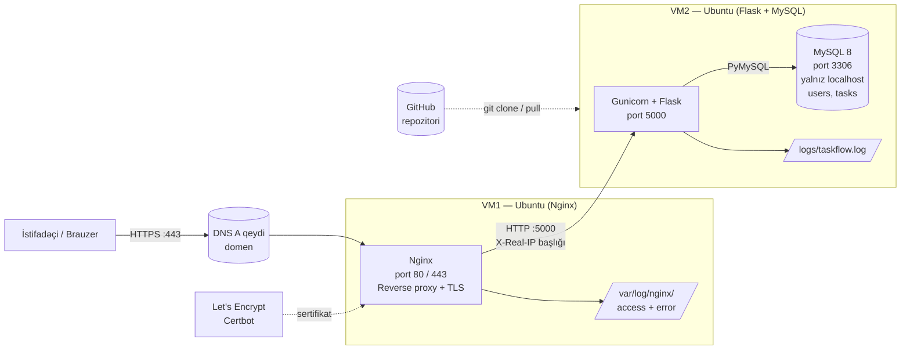
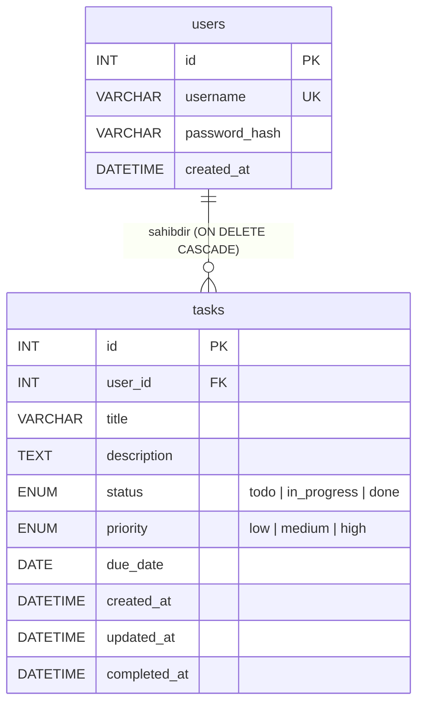

[architecture.md](https://github.com/user-attachments/files/35132768/architecture.md)
# TaskFlow (MySQL) — Arxitektura

## Komponentlər

| Komponent | Rol | Port |
| --- | --- | --- |
| Brauzer (HTML/CSS/JS) | İstifadəçi interfeysi (SPA) | — |
| Nginx (VM1) | Reverse proxy, HTTPS, access log | 80 / 443 |
| Flask + Gunicorn (VM2) | REST API + statik faylların verilməsi | 5000 |
| MySQL 8 (VM2) | `users`, `tasks` cədvəlləri (InnoDB, utf8mb4) | 3306 (localhost) |
| Log sistemi | `taskflow.log` (rotasiya ilə) + Nginx logları | — |

## Verilənlər bazası

İndekslər: `uq_users_username` (unikal), `idx_tasks_user_status (user_id, status)`, `idx_tasks_user_due (user_id, due_date)`.

## API xülasəsi

| Metod | Yol | Təsvir |
| --- | --- | --- |
| POST | `/api/register` | Qeydiyyat |
| POST | `/api/login` | Giriş |
| POST | `/api/logout` | Çıxış |
| GET | `/api/me` | Cari istifadəçi |
| GET | `/api/tasks?status=&priority=&q=&sort=` | Siyahı, filtr, axtarış |
| POST | `/api/tasks` | Yeni tapşırıq |
| PUT | `/api/tasks/<id>` | Redaktə |
| PATCH | `/api/tasks/<id>/status` | Status dəyişmək |
| DELETE | `/api/tasks/<id>` | Silmək |
| GET | `/api/stats` | Dashboard statistikası |
| GET | `/api/health` | Sağlamlıq yoxlaması (DB daxil) |

## Təhlükəsizlik qeydləri

- Bütün SQL sorğuları parametrlidir (`%s`); sütun adları və `ORDER BY` yalnız whitelist-dən seçilir → SQL injection-a qarşı.
- Parollar `werkzeug` ilə hash-lənir.
- Sessiya cookie-si `HttpOnly`, `SameSite=Lax`; HTTPS-dən sonra `TASKFLOW_SECURE_COOKIE=1`.
- Hər sorğu `user_id` ilə süzülür — istifadəçi başqasının məlumatına çata bilmir.
- MySQL yalnız `localhost`-da dinləyir; DB parolu `/etc/taskflow.env` faylındadır (`chmod 640`).
- VM2-də firewall yalnız VM1-dən 5000 portuna icazə verməlidir.
